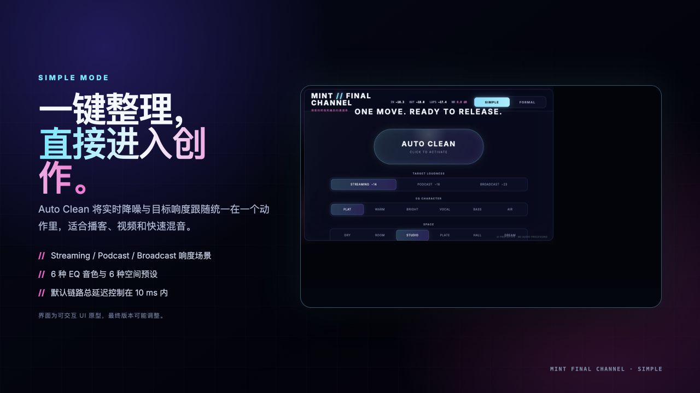

# MINT Final Channel · Mint 的混音通道条（VST3）

[](https://github.com/ysuhao/mint-final-channel/releases/latest)
[](LICENSE)
[](https://github.com/ysuhao/mint-final-channel/releases/latest)

MINT Final Channel is a free, open-source (MIT), bilingual Windows/macOS
channel-strip VST3 for live streaming, podcasts and mixing, with a fast Simple
view and a complete Formal view. Audio processing is fully local: there is no
account, telemetry, networking, or cloud inference.

MINT Final Channel（中文名「Mint 的混音通道条」）是一款免费开源（MIT）、支持中英文
界面的通道条 VST3 插件，同时为直播新手和专业创作者设计。简洁版用于快速完成清理与
发布准备，专业版提供完整的 EQ、降噪、压缩、混响和限制器控制。所有音频处理均在
本机完成，不包含账号、遥测、联网或云端推理。

[Download / 下载](https://github.com/ysuhao/mint-final-channel/releases/latest) ·
[Project page / 作品页](https://mintryu.com/works/mint-final-channel/) ·
[Author / 作者 Mint Ryu](https://mintryu.com/)




## Features / 功能

- Simple and Formal interfaces with persistent `EN / 中文` switching.
- 12-band EQ with filter type and stereo/left/right/mid/side routing.
- Realtime spectral denoising, stereo compression, FDN reverb and look-ahead
  true-peak limiting.
- Allocation-free processing after preparation and stable parameter ordering.
- Formal technical labels remain in English in both interface languages.
- 简洁版提供自动清理、响度目标、均衡风格和空间预设。
- 中文模式采用内嵌圆润字体；专业参数、单位和枚举值保留英文。

## Windows installation / Windows 安装

1. Download `MINT-Final-Channel-0.1.0-Windows-x64.zip` from
   [GitHub Releases](https://github.com/ysuhao/mint-final-channel/releases/latest)
   (a `.sha256` checksum file is attached).
2. Copy `MINT Final Channel.vst3` to
   `C:\Program Files\Common Files\VST3\`.
3. Restart your DAW and rescan VST3 plug-ins.

从 GitHub Releases 下载 `MINT-Final-Channel-0.1.0-Windows-x64.zip`，将
`MINT Final Channel.vst3` 复制到 `C:\Program Files\Common Files\VST3\`，然后重启宿主
并重新扫描插件。

## FAQ / 常见问题

**Is it free? / 免费吗？**
Yes. The plug-in is free and the source code is MIT-licensed.
免费，源码以 MIT 许可开源。

**Which hosts does it work in? / 支持哪些宿主？**
Any DAW or streaming host that loads VST3 plug-ins. Release builds pass
pluginval at strictness level 10 and Steinberg's VST3 validator.
支持加载 VST3 插件的宿主软件。发行版通过 pluginval（严格度 10）与 Steinberg VST3
验证器测试。

**Is there a macOS version? / 有 macOS 版吗？**
The source includes a macOS packaging script, but the published binary is
currently Windows x64 only.
源码包含 macOS 打包脚本，目前公开发布的安装包只有 Windows x64。

**Does it upload my audio? / 会上传音频吗？**
No. The plug-in processes audio locally and makes no network connections.
不会。插件完全在本机处理音频，不进行任何网络连接。

## Build and test

The DSP core has no external runtime dependency:

```sh
cmake -S . -B build -DCMAKE_BUILD_TYPE=Release
cmake --build build --config Release
ctest --test-dir build --output-on-failure -C Release
```

Building the VST3 requires a pinned iPlug2 checkout:

```sh
cmake -S . -B build-plugin \
  -DVAPORWAVE_BUILD_PLUGIN=ON \
  -DIPLUG2_DIR=/absolute/path/to/iPlug2
cmake --build build-plugin --config Release --target VaporwaveSuite-vst3
```

Release builds are validated with the DSP test suite, pluginval at strictness
level 10, and Steinberg's VST3 validator.

## License

Source code is available under the [MIT License](LICENSE). Bundled fonts and
other third-party components retain their own licenses; see
[THIRD_PARTY_NOTICES.md](THIRD_PARTY_NOTICES.md).

Made by [MINT RYU](https://mintryu.com/) · me@mintryu.com
